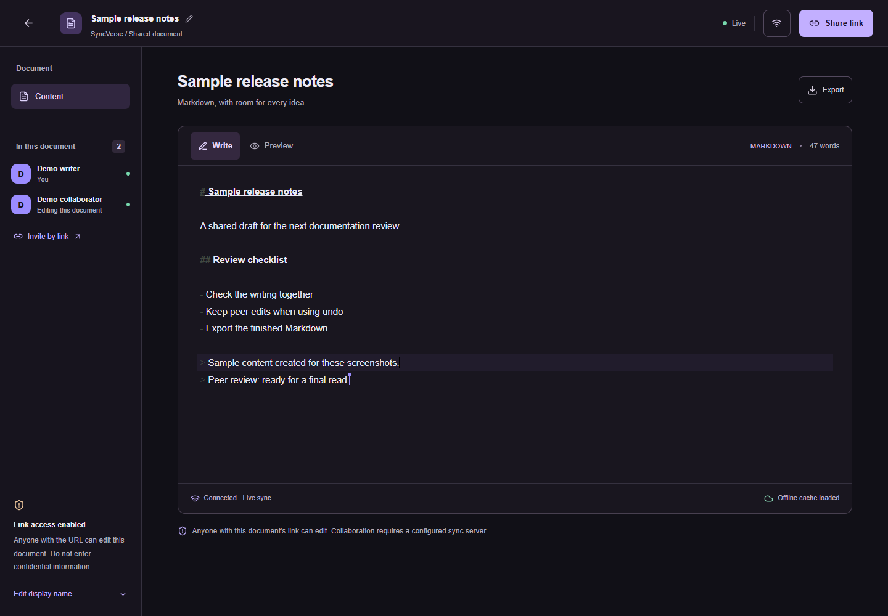

<div align="center">

# ✦ SyncVerse

**A calm space to create together.**

An offline-capable, open-source collaborative Markdown workspace built with Yjs CRDTs, CodeMirror 6, and React.

  

</div>

> **Status — CI-tested development prototype, not production software.** The TypeScript build, six unit tests, and three Chromium multi-browser scenarios pass in GitHub Actions. Real network failure, relay restart recovery, and public deployment remain unverified. There is no authentication, access control, or end-to-end encryption. **Do not use SyncVerse for confidential data.**

Maintained by [Shubh Raghav](https://github.com/SHUBHRAGHAVT-57).

**Stack:** React · TypeScript · Vite · CodeMirror 6 · Yjs · IndexedDB · a local Node.js WebSocket relay.



Actual app capture, 2026-11-19; sample document and participants. [Desktop/mobile walkthrough](docs/WALKTHROUGH.md) · [Engineering decisions](docs/ENGINEERING.md) · [Current verification](docs/VERIFICATION.md).

## What the first release contains

- **Live collaborative Markdown editing** using a `Y.Text` CRDT and the CodeMirror 6 Yjs binding.
- **Presence and remote cursors** via Yjs awareness, plus shared document titles.
- **Offline edit persistence** via IndexedDB; queued updates can synchronize after connectivity returns. A manual pause/resume button lets you deliberately work without the relay.
- **Local development relay** using the Yjs v13-compatible `y-websocket@2.1.0` server and LevelDB persistence.
- **Workspace home** with recent links, new-document creation, search, and per-device display name/color.
- **Markdown preview and export** with raw HTML and external images disabled in the preview.
- **Local undo/redo and selection retained across Preview.** Local undo preserves edits received from peers.
- **Tests** for utility invariants and multi-browser collaboration scenarios.

### Product boundaries

- The local **recent documents list** is device-specific and is not synced between devices.
- A random UUID link provides only unguessability, **not permission enforcement**. Anyone who knows the URL can edit.
- The relay is intended for **local development** only. Do not expose it publicly without access control, transport encryption, rate limits, backups, and operational hardening.
- Offline editing works after the app has loaded. It is **not yet a fully installable offline PWA**; an offline cold load is not guaranteed.
- No production collaboration backend, user accounts, permissions, boards, document deletion API, end-to-end encryption, or hosted demo is included.

## Requirements

- **Node.js 22.12+** and npm 10+
- A modern browser with IndexedDB support (Chromium recommended)

## Run locally

```powershell
# From the repository root, on Windows PowerShell
npm.cmd ci
npm.cmd run dev
```

On macOS/Linux:

```bash
npm ci
npm run dev
```

Open **http://127.0.0.1:5173**. The development command starts both a Vite frontend (5173) and the WebSocket relay (127.0.0.1:1234). The relay keeps a LevelDB database in `.syncverse-data/` (gitignored).

Create a document, copy the link, and open that link in a second browser context. Start typing in each window; changes should sync when both show **Live**. Disconnect one browser and make edits; they are held locally by IndexedDB and should merge upon reconnect.

If you want to run the two processes separately:

```powershell
npm.cmd run dev:server
# Second terminal:
npm.cmd run dev:web
```

### Windows: LevelDB `LOCK` watcher errors

The relay stores runtime data under `.syncverse-data/`. Vite excludes that directory from its file watcher to avoid Windows `EBUSY` errors on LevelDB's `LOCK` file. If you see this warning on an older checkout, stop the development server with Ctrl+C, run `git pull`, and restart with `npm.cmd run dev`. You do not need to delete the database or its lock file.

### Configure another relay

Copy `.env.example` to `.env.local`, and change `VITE_SYNCVERSE_WS_URL` to your accessible WebSocket endpoint. For a deployed HTTPS frontend, use a `wss://` endpoint. Without that variable, production hosts do not automatically connect to an insecure default endpoint; the workspace will remain **Local only**.

The reference Yjs WebSocket server used here is for development. See [Architecture](docs/ARCHITECTURE.md) and [Security](docs/SECURITY.md) before exposing any host to the internet.

## Tests and checks

```powershell
npm.cmd test         # Pure utility tests, Node built-in runner
npm.cmd run typecheck
npm.cmd run build
npm.cmd run test:e2e # Requires npm.cmd exec -- playwright install chromium once
npm.cmd run test:recovery
```

Playwright starts and stops the test services on loopback. The end-to-end suite uses frontend port 5173 and relay port 1234. Recovery uses 5174 and 1235. Set `SYNCVERSE_TEST_WEB_PORT` and `SYNCVERSE_TEST_RELAY_PORT` to use free ports if another process is listening. Run `npm exec -- playwright install chromium` if the browser is missing. GitHub Actions runs both suites on pull requests and pushes to `main`.

**Reproducible installs:** `package-lock.json` is committed and GitHub Actions runs `npm ci`. Update dependency versions intentionally, inspect the resulting lockfile diff, and run the complete check suite before merging.

The recovery suite starts a relay with a disposable LevelDB database. It stops and restarts the process, merges edits made during the outage, then closes the original clients and checks restoration from a fresh browser after another restart. See the local results and open checks. [Verification](docs/VERIFICATION.md)

## How it works

```text
  Browser A                          Browser B
  ┌────────────────────┐             ┌────────────────────┐
  │ CodeMirror + Yjs   │             │ CodeMirror + Yjs   │
  │ IndexedDB cache    │             │ IndexedDB cache    │
  └─────────┬──────────┘             └─────────┬──────────┘
            │ WS updates + awareness           │
            └─────────────┬────────────────────┘
                          │
                ┌─────────▼──────────┐
                │ y-websocket relay  │
                │ LevelDB on disk    │
                └────────────────────┘
```

Yjs handles concurrent text operations with mergeable CRDT document updates. CodeMirror's binding handles editor updates, awareness-based remote cursors, and local undo tracking. IndexedDB persists the local document state between visits; the WebSocket provider distributes edits between browsers.

See [Architecture](docs/ARCHITECTURE.md), [Engineering decisions](docs/ENGINEERING.md), [Security](docs/SECURITY.md), and [Roadmap](docs/ROADMAP.md).

## Repository layout

```text
src/
  App.tsx                     Route state and identity dialog
  components/
    Workspace.tsx             Home, recent documents, search
    DocumentRoom.tsx          Room header, presence, editor + preview
    MarkdownEditor.tsx        CodeMirror <-> Y.Text binding
  lib/
    documents.ts              Pure document and URL logic
    storage.ts                Per-device history and identity
    collaboration.ts          Websocket/IndexedDB session lifecycle
  styles/global.css          Responsive visual design

tests/
  documents.test.ts           Pure tests, no external dependencies
  e2e/collaboration.spec.ts   Two-browser integration scenarios
.github/workflows/ci.yml     Automated checks
```

## Contributing

Pull requests are welcome. Please read [CONTRIBUTING.md](CONTRIBUTING.md). Keep offline correctness, security boundaries, testability, and accessibility at the center of every change.

## License

MIT © 2026 Shubh Raghav for repository code covered by [LICENSE](LICENSE). Yjs, CodeMirror, React, Lucide, and other dependencies retain their licenses and copyright notices. Their implementations are not claimed as original SyncVerse code.
