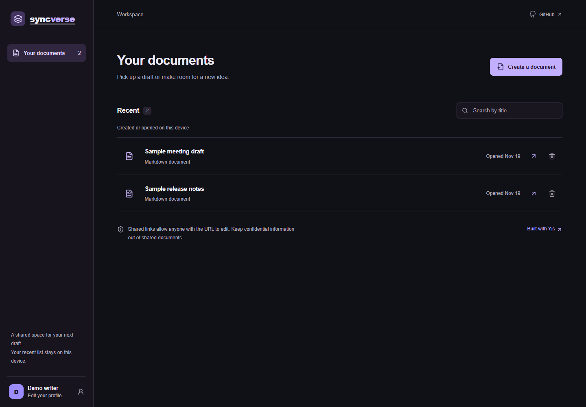
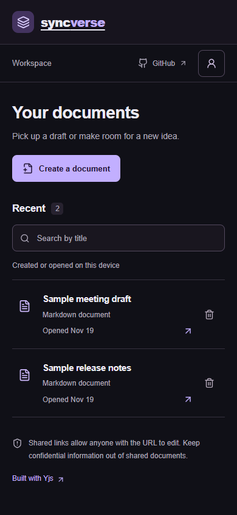
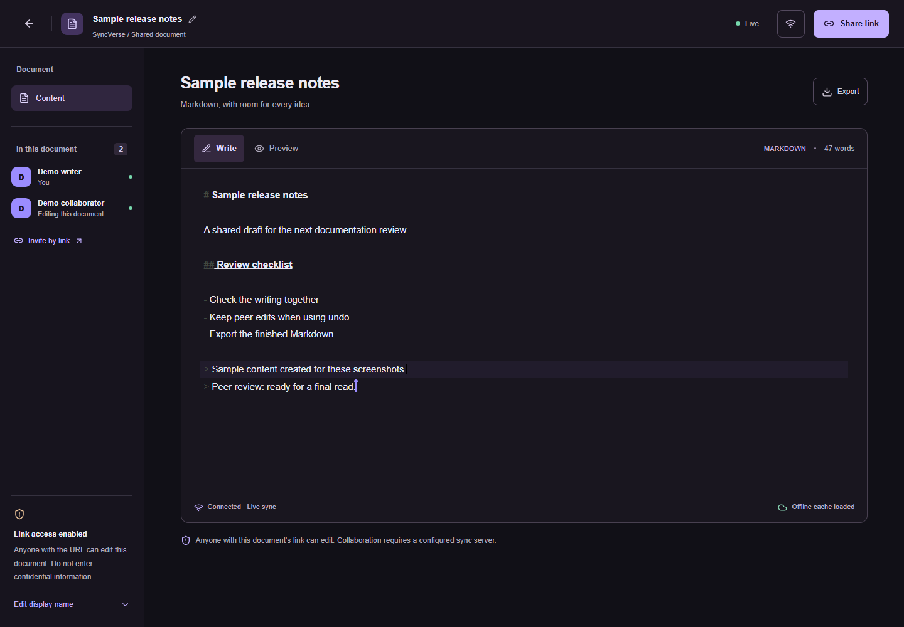
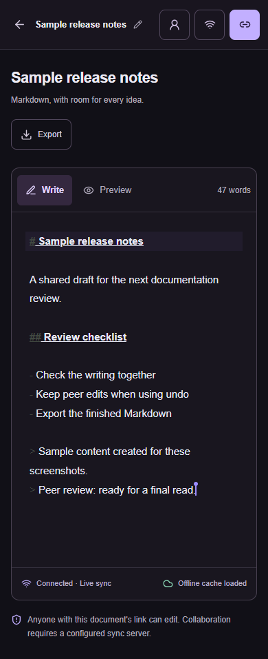
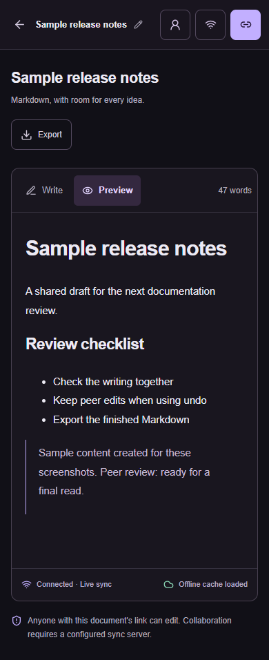

# SyncVerse walkthrough

Actual built-app captures from 2026-11-19, using a local relay and two independent Chrome contexts. “Demo writer,” “Demo collaborator,” and both documents are sample data created through the app. Remote fonts were blocked to exercise fallback typography. Desktop uses 1440×1000 CSS pixels; mobile uses a 390×844 emulated viewport.

## Create and return to a draft

Run `npm run dev`, open `http://127.0.0.1:5173`, and choose **Create a document**. Rename it from the room header. **Back to workspace** shows device-local recents; search filters titles and the remove action forgets a link without deleting the shared document.

## Share and write together

Choose **Share link** and open it in another browser profile/private window. Both should show **Live** after exchanging the document. Participant names and cursors are ephemeral awareness state. These captures show real local demo clients, not production users.

## Preview, undo, and export

Select text, open **Preview**, return to **Write**, and continue typing: selection and local history remain in the same editor. On Windows, Ctrl+Z undoes a local edit and Ctrl+Y redoes it. Peer edits remain intact. **Export** downloads shared Markdown as `.md`. Raw HTML and external images remain disabled in Preview.

For deliberate offline work, **Pause sync**, edit, then **Resume sync**. A disconnected state means changes have not reached the relay. “Offline cache loaded” acknowledges initial loading, not every subsequent durable write. See [Verification](VERIFICATION.md) for interruption/restart evidence and [Security](SECURITY.md) for link-access limits.
